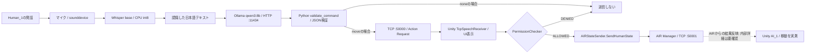

# CH12 — Portable Environment

## 1. 目的と位置づけ

本章は、AI_MR_Sandbox の研究・実装環境を複数の Windows PC で再現するため、
従来の「Portable SSD 上にソースと Python 仮想環境が同居する方式」を見直し、
環境の責務を A・B・C の3区分に分離した経緯、実装、検証結果を記録する。

本章で検証したのは**環境パスの解決、環境診断、Bootstrap の事前安全検査**である。
新しい PC 側 Runtime の実インストール、GPU 動作、Unity / AIR の End-to-End 動作、
旧 PC での新方式再検証は、まだ完了していない。

## 2. A・B・C の環境分離

| 区分 | 責務 | 代表的な保存先 |
| --- | --- | --- |
| A: PC 環境 | 仮想環境、AI モデル、キャッシュ、PC 固有設定 | `C:\AI_MR_Sandbox`、`C:\AI_venvs` |
| B: ユーザ Workspace | 学習データ、生成物、実験ログ、ユーザ固有データ | `user.json` で指定 |
| C: Portable 環境 | 共通ソース、Unity 資産、bootstrap、依存記述、文書 | Portable SSD 内の `AI_MR_Sandbox` |

SSD ドライブ文字や Windows ユーザ名をプログラム内に固定しない。
C 区分の既存 `.venv` は、従来環境の復元性を確保するため、削除・更新しない。

### 2.1 PC 設定（A）

既定の設定ファイルは `C:\AI_MR_Sandbox\config\machine.json`。
別の場所を指定する場合は環境変数 `AI_MR_MACHINE_CONFIG` を使用できる。

```json
{
  "schema_version": 1,
  "pc_root": "C:\\AI_MR_Sandbox",
  "venv_root": "C:\\AI_venvs"
}
```

### 2.2 ユーザ設定（B）

`%APPDATA%\AI_MR_Sandbox\user.json` に `workspace_root` を記述する。
実際のパスは各 PC・Windows アカウントごとに設定する。

```json
{
  "schema_version": 1,
  "workspace_root": "D:\\Research\\AI_MR_Workspace"
}
```

設定値は例示であり、Workspace の実在や書き込み可能性を保証するものではない。

## 3. CH12 で追加したスクリプト

| ファイル（`bootstrap/`） | 役割 |
| --- | --- |
| `resolve_environment.ps1` | A・B・C の設定を読み、各パスを解決する |
| `setup_python_environment_pc.ps1` | PC 側 Runtime 環境構築用。通常は Preview のみ |
| `verify_runtime_environment_pc.ps1` | Level 2：ソースと実行環境の存在確認 |
| `verify_runtime_health_pc.ps1` | Level 3：環境が存在する場合だけ基本的な実行診断 |

これら4ファイルは、安全対策を含めて `portability-cleanup` ブランチの
Git コミット `ee814c7` に記録した。新方式の実インストールは未検証である。

### 3.1 Resolver の出力

`RepoRoot`, `PcRoot`, `VenvRoot`, `RuntimePython`, `ImagePython`,
`ModelsRoot`, `CacheRoot`, `WorkspaceRoot` を返す。
Resolver は設定を読み込むのみで、ディレクトリを作成しない。
設定欠落・必須項目欠落は例外で報告する。

### 3.2 新 Bootstrap の動作モード

| 指定 | 動作 |
| --- | --- |
| 指定なし | 設定とインストール先を表示し、変更しない |
| `-CheckInstallSafety` | 安全条件を検査し、インストール前に終了する |
| `-Install` | 条件を満たす場合にのみ PC 側 Runtime を新規構築する |

既存 `AI_MR_Sandbox_Runtime` ディレクトリがある場合は構築を拒否する。
Portable リポジトリ内部、およびそのリポジトリと同じドライブ文字への
仮想環境配置を拒否する。指定パスが再解析ポイントである場合も一部拒否する。

**注意：** 同一物理ボリュームを指す異なるドライブ文字、親ディレクトリの
ジャンクションやマウントポイントなど、すべての経路転送を検出できるわけではない。
`-Install` は本章の検証では実行していない。保護コードの完成を意味しない。

### 3.3 Level 2 と Level 3 の判定

Level 2 は主要ソース8ファイルと Runtime / Image Python、Workspace、
旧 `.venv` の存在状況を報告する。
Level 3 は Runtime がある場合に import と `pip check` を、
Ollama が PATH にある場合にモデルと API を確認する。

未構築時は `SKIPPED` / `NOT INSTALLED` 等と表示する。
**検証スクリプトの正常終了は、未構築システムの実行可能性を意味しない。**
現行 Level 3 は FAIL を必ずしも終了コードへ反映しないため、
自動合否判定への利用前に改修が必要である。

## 4. 実施した検証と結果

| 項目 | 結果 | 留意点 |
| --- | --- | --- |
| Resolver 正常系 | PASS | 異なる PC・SSD ドライブ文字で確認 |
| Resolver：設定ファイル欠落 | PASS | 期待どおり例外を検出 |
| Resolver：必須キー欠落 | PASS | `pc_root` 不足を検出 |
| Bootstrap 通常 Preview | PASS | インストールなし |
| Bootstrap 安全検査 | PASS | Runtime 未構築時に正常終了 |
| SSD 同一ドライブ拒否 | PASS | テスト設定を用いた拒否確認 |
| 既存 Runtime 拒否 | PASS | 一時ディレクトリを使って確認 |
| Level 2 診断 | PASS | ソース8件存在、PC側 Runtime は未構築 |
| Level 3 診断 | PASS（スキップ動作） | Python・Ollama の実行検証は未実施 |
| requirements lock の pip dry-run | PASS | Python 3.11 / Windows x64、27固定パッケージ |
| `pip==26.2.1` dry-run | PASS と報告 | 実インストールなし |
| `-Install` | 未実施 | 実環境構築・実行テストは今後 |
| GPU / CUDA / Unity / AIR | 未実施 | End-to-End 再現性は未評価 |

複数 PC でのパス解決例：

- ある PC：Portable リポジトリが `F:\AI_MR_Sandbox`、Workspace はその PC のユーザ設定による。
- `DESKTOP-TIPMO1S`：Portable リポジトリが `E:\AI_MR_Sandbox`、
  ユーザ Workspace 設定は `C:\Users\vruser_1\AI_MR_Workspace`。
  この Workspace は当時未作成、PC 側 Runtime と Image Python も未構築であった。

上記は別PCで異なる設定が使われることの検証であり、
同一ソースによる一連の実験が両PCで成功したことまでは示さない。

## 5. Runtime パッケージ再現性

`bootstrap/requirements-runtime-lock.txt` の固定27パッケージを用い、
Python 3.11.9 / Windows x64 の `pip install --dry-run --ignore-installed
--only-binary=:all:` で依存解決を確認した。

これは Python パッケージのインストール計画の検査であり、
インストール済み環境の import 成功、Whisper 推論、Ollama 接続、
CUDA / cuDNN 対応、GPU 動作を保証しない。

## 6. CH11 の環境記述との関係

`CH11-DemoReproduction.md` は当時のデモ再現手順として保存する。
そこに記録されたリポジトリ直下の `.venv` や個別 PC のパスは
**CH11 当時の実装環境を示す歴史的記録**である。
CH12 の3区分設計に合わせて遡及的に書き換えない。

また、従来の `setup_python_environment.ps1` と
`verify_runtime_environment.ps1` は初期移行段階では保持する。
新しい PC 対応版とは並行して取り扱い、旧機の互換性を確認したのちに移行を判断する。

## 7. 未完了事項・次段階への申し送り

1. Python Runtime を PC 側に実際に新規構築し、import・`pip check`・実処理を検証する。
2. `-Install` 前に、親ディレクトリの再解析ポイント、実ボリューム等を含む安全条件を再検討する。
3. Runtime と画像生成・学習環境の起動スクリプト全体を Resolver 参照へ順次移行する。
4. Unity プロジェクトの PC 固有キャッシュと Portable 資産の分離方式を決定する。
5. Ollama / Whisper / Unity / AIRManager を結ぶ動作確認、GPU 検証を実施する。
6. 元の PC と、複数の別PCで同一実験を再現し、結果を記録する。
7. 新旧ドキュメントの索引・参照を確認し、正式な移行手順を整備する。

## 8. 安全運用原則

- 新旧スクリプトを混同せず、`-Install` は保護条件の再確認まで実行しない。
- Portable SSD の既存 `.venv` は維持する。
- A/B の設定ファイルと実行環境は各 PC で独立して扱う。
- 変更操作は Preview → 検証 → Apply → Git 差分確認 → Commit の順に行う。
- 文書化した PASS / SKIPPED / 未実施の境界を明示する。

## 9. 文書体系の整理と履歴保全方針

本節は、Portable環境の再現性を支える文書管理規則を定める。
技術の実装状態だけでなく、各開発段階の記録・参照・原本の追跡可能性を維持する。

### 9.1 命名規則と章番号

- 正式な章ファイル名は `CH番号-主題.md` を用いる（例：`CH08-AIRManagerIntegration.md`）。
- 枝番号 `CH01.1`、`CH10.5`、`CH10.6`、`CH10.7` は開発履歴上の順序として維持する。
- CH01〜CH12の正式文書は計16件とし、正式な目録は `documents/README.md` とする。
- 章ファイル名を変更するときは、対応表を作り、衝突・欠落・参照先を事前確認する。

### 9.2 歴史的記述と運用参照を区別する

- 過去の検証名 `CHECKPOINT-1` など、本文中に残る歴史的表現は一括置換しない。
- 新しいファイルを指す実際のファイル名参照・リンクのみ、対象を限定して修正する。
- CH11に記録された当時のPC固有パスや `.venv` の表記は、
  その時点の再現手順を示すため、新方式に合わせて遡及変更しない。
- 変更内容の確認には、改名と内容差分を区別して確認できるGitを使用する。

### 9.3 原本・重複資料・変換作業の保全

- DOCXなどの原本は、Markdownへの変換が検証できても直ちに削除しない。
- CH11のMarkdown化では、原文段落・表の整合性を監査してから正式版を採用した。
- `documents/CH09-MREALIntegration.md` を正式版として整理した後も、
  内容が一致しない `python/CHECKPOINT-9.md` は未統合のため保全する。
- 変換ドラフト・補助スクリプトの採否や削除は、正式文書の確定後に別途判断する。

### 9.4 索引と参照整合性

- `documents/README.md` は各章の番号、正式ファイル名、主要主題を示す入口とする。
- READMEの旧来の3行の実装メモは原文のまま残すが、
  現行の実行環境と同一であることを保証するものではない。
- README内のリンク先について、ファイルの存在を確認してから索引を変更する。
- CH12でいう「検証済み」「未実施」「SKIPPED」は区別し、
  文書が存在することだけをもって実装・実行の成功とみなさない。

### 9.5 変更手順とGitの履歴

文書改名・本文修正・索引更新は、原則として
**Preview → 検証 → Apply → Git差分確認 → Commit** の順序で行う。
他の未登録スクリプトやドラフトを誤ってコミットしないよう、対象ファイルを指定する。

今回の文書整理で確定した主なGitコミット：

- `4aff369`：CH09の正式Markdown文書の整理。
- `39748b8`：CH11の正式Markdown文書を追加。
- `d7132b7`：CH01〜CH10の13件を改名し、運用上のファイル参照5件を修正。

本節の作成時点で、CH12本文とREADME索引の追加分は未コミット。
このため、コミット完了後に文書の記述とGit履歴の整合性を再確認する。

## 10. PC側Runtimeの実機再現性検証（2026-10-31 追補）

この節は、前節までの設計・事前検証を踏まえ、2026年10月31日に事務・文書作成用PCで追加実施した**実機検証**の記録である。
第1～9節に残る「Runtime未インストール」「End-to-End未実施」等は**それぞれの節を作成した時点の状態**であり、本節が後日の到達状況を記録する。
過去の記述を事後的に成功へ書き換えない。

### 10.1 検証したPCと配置

| 項目 | 実際の検証環境 |
| --- | --- |
| PC | `DESKTOP-TIPMO1S`、Windows 11 Pro、Intel Core i7-1065G7、RAM 32GB、Intel Iris Plus Graphics |
| C：Portableリポジトリ | `E:\AI_MR_Sandbox`（当該PCでのドライブ文字） |
| A：PC側Python Runtime | `C:\AI_venvs\AI_MR_Sandbox_Runtime\Scripts\python.exe` |
| A：Ollamaモデル | `C:\AI_MR_Sandbox\models\ollama`（環境変数 `OLLAMA_MODELS`） |
| A：Whisperのモデル／キャッシュ | `C:\AI_MR_Sandbox\models\faster-whisper` を指定して使用 |
| B：ユーザWorkspace | `C:\Users\vruser_1\AI_MR_Workspace`（設定値。検証開始時点では未作成） |

このPCではPC側Runtimeを新規構築し、固定パッケージ27件をインストールした。
`pip check`、Level 3のPython import検査はPASSした。Portable SSD上の旧 `.venv` は保全した。

**Unityプロジェクトの役割区分（2026-10-31の検証対象）**

- 公式基準版：`unity/MREAL_OpenXR_Sample6_Haptic_Sandbox`。
  Unityプロジェクトには最小限の機能を維持する方針であり、
  今回のマイク → Whisper → Qwen3:8b → Unity → AIR Manager → AI_1移動の
  End-to-End実機検証には、この公式基準版を使用した。
- GUIテスト派生版：`unity/MREAL_OpenXR_Sample6_Haptic_Sandbox_ollama_test`。
  共同研究者が、音声認識・Qwenの代わりにUnity上のGUIから操作を試せるよう、
  テスト用機能を追加したプロジェクト。開発時系列では後発だが、
  公式基準版を置き換えるものではない。
- したがって、**開発時系列上の新しさ**と**公式基準版としての採用**を
  混同しない。GUIテスト派生版の機能を公式基準版へ無条件に取り込まない。

### 10.2 起動する実体と役割

| 実行実体／ファイル | 役割 | 通信・実行条件 |
| --- | --- | --- |
| `ollama.exe`（PC側） | `qwen3:8b` の推論を提供 | ローカルHTTP API `127.0.0.1:11434` |
| `C++/AIRManager_v2/x64/Debug/AIRManager.exe` | AIRの独立した実行系 | `127.0.0.1:50001` でTCP待受を実測 |
| Unity Editor：`unity/MREAL_OpenXR_Sample6_Haptic_Sandbox` | Sample6をPlayし、Action受信・表示・移動反映を行う | `TcpSpeechReceiver` が `127.0.0.1:50000` でTCP待受を実測 |
| `python/speech_to_unity_ollama.py` | マイク → Whisper → Ollama解釈 → JSON検証 → UnityへのTCP送信 | PC側Python Runtimeで実行。`--send` のときだけUnityへ送信 |
| Unity `TcpSpeechReceiver.cs` | JSON受信、UI更新、Permission判定、AIRへの送信呼び出し | `PermissionChecker.IsAllowed(request)` を実行 |
| Unity `AIRStateSender.cs` | `SendHumanState(direction)` によりAIR側へ状態を送る | 送信失敗時は `AIR Send Error` を記録 |
| Unity `AI_1` | 身体基準のAction実行対象 | 移動対象はUnity実装側で固定。Action JSONに対象名はない |

`AIRStateSender` とAIR Managerの**詳細な送受信JSON、AIR側での目標位置計算、Unityへの結果反映方式は、この試験ログだけでは確定できない**。
実機でAI_1の移動は観測できたが、これらのプロトコル内部の仕様はソースコード照合による追加文書化が必要である。

### 10.3 データフロー（観測結果と実装コードに基づく）



マイク音声は `sounddevice` で44,100Hz・モノラル・5秒・16bitとして取得し、一時WAVへ保存してからWhisperで日本語認識する。
Whisperは `faster-whisper` の `base`、CPU、`int8` モード。
WAVは一時ディレクトリ内で扱われ、当該スクリプトでは録音データの恒久保存を行わない。

Pythonは認識文字列をOllamaの `/api/generate` に送り、`think:false`・`stream:false`・JSONスキーマ制約により
`{ "action": "move|none", "direction": "right|left|forward|none" }` の形式で分類させる。
PythonがActionと方向の組合せを検証してから、次のUnity用データを生成する（右側移動の例）。

```json
{
  "type": "action_request",
  "speaker": "Human_1",
  "action": "move",
  "reference": "Human_1",
  "direction": "right"
}
```

このJSONの送信先は `127.0.0.1:50000` である。移動対象 `AI_1` はJSONには含まれず、Unity側で固定する設計。
「Human_1の右／左／正面から水平1m」の移動を要求する仕様だが、**今回の実測では距離1mの数値測定までは行っていない**。

### 10.4 再現操作手順（このPCで確認した順序）

**前提：** Portable SSDを接続し、リポジトリルート `E:\AI_MR_Sandbox` を作業ディレクトリとする。
別PCではドライブ文字とマイク番号・Python実行パスをそのPCに合わせる。Unity Projectの資産と設定を変更する前に、現在の状態を保持する。

1. **Ollamaを起動する。** WindowsアプリとしてOllamaを起動したうえで、別PowerShellからHTTP APIが応答し `qwen3:8b` が登録されていることを確認する。

   ```powershell
   $r=Invoke-RestMethod -Uri 'http://127.0.0.1:11434/api/tags' -TimeoutSec 5; $r.models | Select-Object name
   ```

2. **AIR Managerを起動する。** Unityに移動命令を送る**前に**起動すること。研究用PCでの再現手順では、起動漏れが接続拒否につながった。

   ```powershell
   $exe=(Resolve-Path -LiteralPath '.\C++\AIRManager_v2\x64\Debug\AIRManager.exe').Path; Start-Process -FilePath $exe -WorkingDirectory (Split-Path -Parent $exe) -PassThru | Select-Object Id,ProcessName,HasExited
   ```

3. **Unityを起動する。** `unity/MREAL_OpenXR_Sample6_Haptic_Sandbox` の対象シーンを開き、Playモードにする。
   このPCではTMPの標準フォントを `LiberationSans SDF` に設定した。Hapticデバイスがない状態で `HapticsDirect` のDLLエラーは残ったが、今回のTCPおよびAI_1移動は実行できた。
   ただしHaptic機能は検証していない。

4. **ポート待受を別PowerShellから確認する。** 50000はUnity、50001はAIR Manager。単に待受中であるだけで、移動成功を意味しない。

   ```powershell
   Get-NetTCPConnection -State Listen -ErrorAction SilentlyContinue | Where-Object { $_.LocalPort -in @(50000,50001) } | Select-Object LocalAddress,LocalPort,OwningProcess
   ```

5. **まず確認モードでAction JSONを試す。** `--send` を付けない場合はUnityへ送信されない。

   ```powershell
   & "C:\AI_venvs\AI_MR_Sandbox_Runtime\Scripts\python.exe" ".\python\speech_to_unity_ollama.py" --text "私の前に来てください"
   ```

6. **テキストからのAIR移動を確認する。** UnityをPlay、AIR Managerを起動したまま実行する。

   ```powershell
   & "C:\AI_venvs\AI_MR_Sandbox_Runtime\Scripts\python.exe" ".\python\speech_to_unity_ollama.py" --text "私の右側に来てください" --send
   ```

   Pythonの `Unityへ送信しました` は送信の報告にすぎない。Unity側で `AI_1` のTransform Positionが変化し、右側へ移動したことを直接確認する。

7. **音声からの完全統合試験。** このPCでのマイク番号は `1`（Realtek Microphone Array）。別PCでは `sounddevice.query_devices()` で確認する。

   ```powershell
   $env:HF_HUB_CACHE='C:\AI_MR_Sandbox\models\faster-whisper'; & "C:\AI_venvs\AI_MR_Sandbox_Runtime\Scripts\python.exe" ".\python\speech_to_unity_ollama.py" --device 1 --send
   ```

   プログラムの案内に従ってEnterで5秒録音し、「私の左側に来てください」と発話する。
   Whisperの認識、Qwenの分類、Unity側のAction/Direction/Reference表示、**AI_1の左側への移動**を確認する。
   終了時は `q` を入力する。

### 10.5 実測結果と確認できた範囲

| 検証対象 | 結果 | 根拠・限界 |
| --- | --- | --- |
| PC側Python Runtime構築 | PASS | 27件の固定依存導入・`pip check` 成功 |
| マイク録音 | PASS | デフォルトRealtekマイク、5秒、44,100Hz。RMS 0.037354、Peak 0.298523 |
| Whisper日本語認識 | PASS | 発話「私の前に来てください」を一致して文字化 |
| Ollamaとモデル配置 | PASS | `qwen3:8b` 5.2GB、`C:\AI_MR_Sandbox\models\ollama` にblob 6件 |
| Qwen3:8bのCPU推論 | PASS | CPU 100%、初回応答10.9秒、モデル読込5.9秒、27 tokens、7.62 tokens/s、context 2048 |
| テキスト→Action JSON | PASS | `move/forward` と `move/right` が期待するスキーマで生成された |
| UnityのTCP受信 | PASS | `127.0.0.1:50000` にUnityが待受、Action/Direction/Reference表示を確認 |
| AIR Managerの起動・待受 | PASS | `AIRManager.exe`、`127.0.0.1:50001`、検証時PID 1380 |
| テキスト→Unity→AIR→AI_1 | PASS | AIR Manager起動後、右側へのAI_1移動を目視確認 |
| マイク→Whisper→Qwen→Unity→AIR→AI_1 | PASS | 「私の左側に来てください」でAI_1の移動を目視確認 |
| 移動距離1mの精度 | 未測定 | Transformの数値・許容誤差を記録していない |
| ActionVerifierの独立判定 | 未確認 | 本試験ではVerifierによる合否ログを検証していない |
| Experience／JSONL永続記録 | 未確認 | 本試験ではログの内容・保存先を確認していない |
| Hapticデバイスの稼働 | 未確認 | DLLロードエラーはあるが、主要な移動動作とは切り分けた |

### 10.6 失敗時の切り分けとログ解釈

- **Unityの画面にAction等が出るがAI_1が動かない場合：** AIR Managerの起動とTCPポート50001の待受を先に調べる。
- `AIR Send Error: ...接続できませんでした`：今回の実例ではAIR Managerの起動漏れと整合し、起動後に移動が成功した。ただし別の原因もあり得る。
- `Action executed through AIR Manager.`：`TcpSpeechReceiver.cs` が `SendHumanState` 呼出し後に出すログ。**AIRの受理・実行成功のACKではない**。エラー発生と同時に表示され得る。
- `Unityへ送信しました`：PythonのTCP `sendall` 完了表示であり、**Unity側の実行結果を受信したものではない**。
- `Permission: DENIED`：PermissionCheckerの判定とInspector参照を確認する。迂回や無条件許可への変更はしない。
- `HapticsDirect` の `DllNotFoundException`：今回のAI_1移動成功とは別問題として記録。必要になるまで関連プラグインの削除や設定変更をしない。
- `Default Font Asset`：別PCでTMP参照エラーが出た場合は、`LiberationSans SDF` と各UIのフォント・マテリアル参照を確認する。

### 10.7 本試験の意義と今後の検証

GPUを持たない事務用PCでも、**マイク → Whisper → Qwen3:8b → UnityのAction受信／Permission → AIR Manager → AI_1移動**の機能的再現性が確認された。
これは**動作する経路の確認**であり、リアルタイム性能、位置決め精度、AIR内部状態、Verification、Experienceまでのすべてが検証されたことを意味しない。

次段階では、`AIRStateSender.cs` と `AIRManager_v2` の通信データ形式・戻り値処理をソースで照合し、
許可判定・AIR実行・位置検証・Experience記録をログで独立に確認する。
起動順序、通信先、未確認項目は他PCの再現手順にも反映する。
